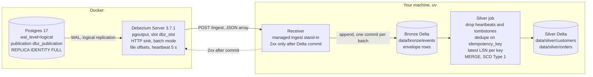
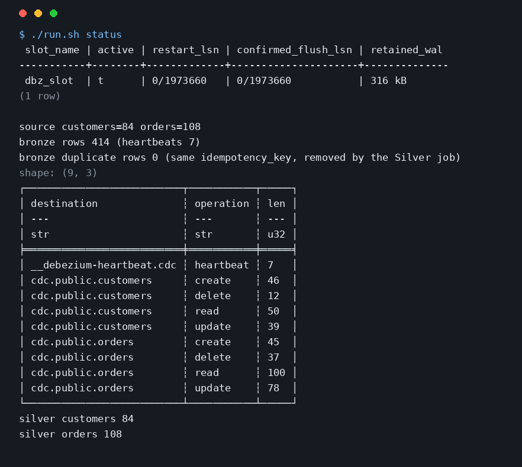
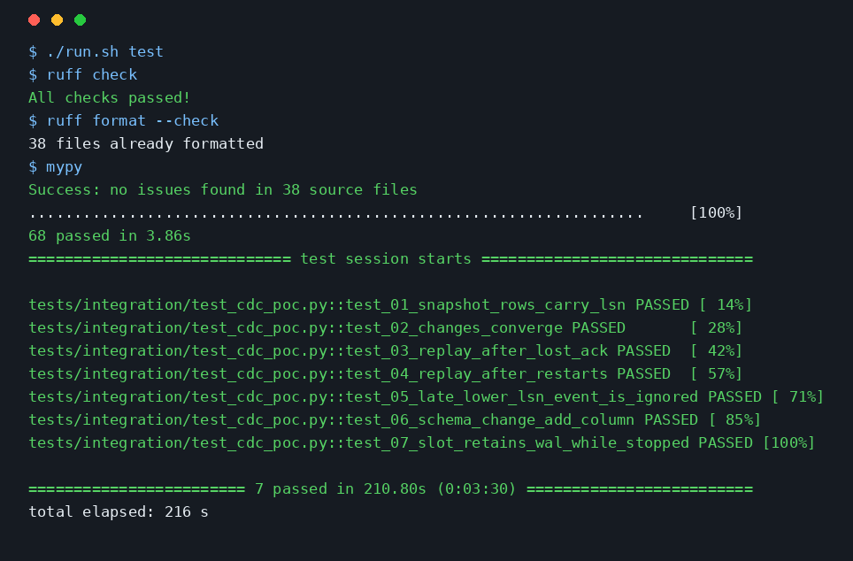
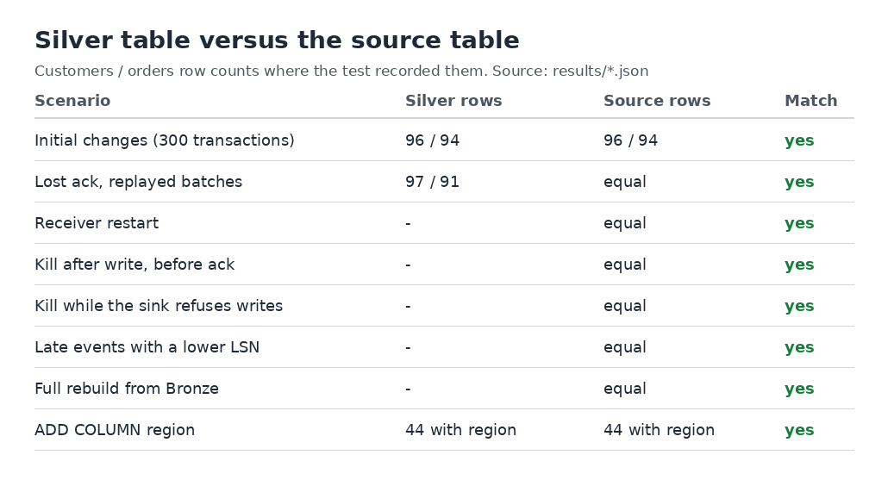
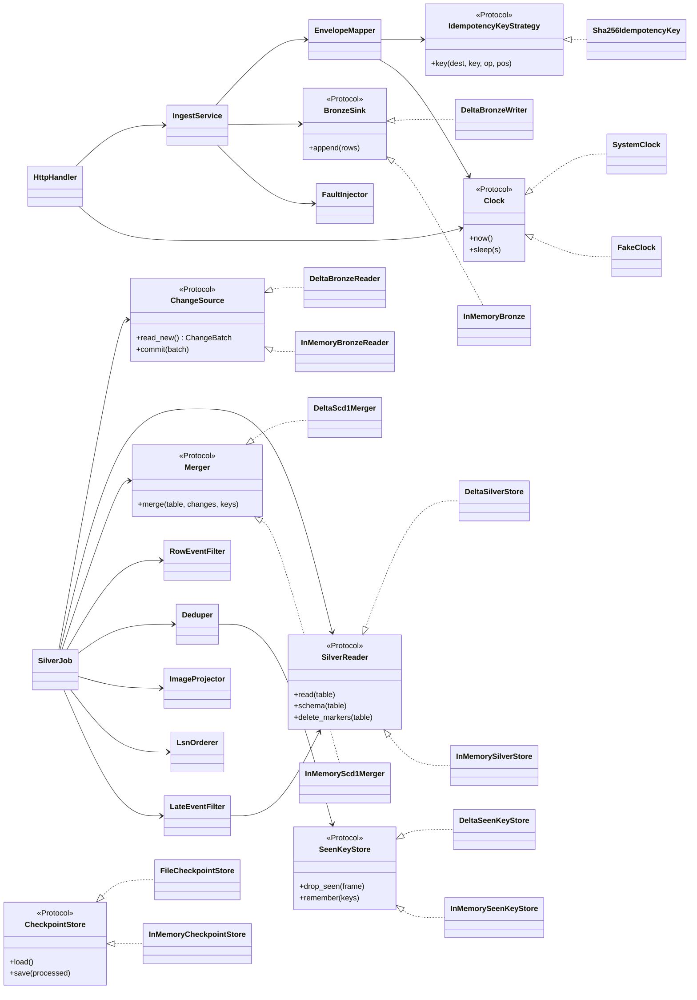

# Postgres CDC Into Delta Without a Broker

A fully local proof of concept for push-based change data capture (CDC).


## The problem

Moving Postgres changes into a lakehouse table usually means running a message broker just to carry events between
the database and the table writer. That is one more cluster to size, secure and watch. Newer lakehouse ingest
services accept events pushed straight from Debezium Server, which removes the broker, but it raises questions that
are easy to get wrong: what happens when an acknowledgment is lost, what order do events arrive in, does a snapshot
row carry a usable log position, and what does an idle replication slot do to the disk? This project answers those
questions with code you can run on a laptop, and it keeps the answers as repeatable tests.

## What this proves

- **No broker needed locally.** Debezium Server reads the Postgres WAL and pushes batches over HTTP to a small
  receiver. The receiver stands in for a managed ingest service. There is no Kafka anywhere.
- **At-least-once delivery is safe.** Lost acknowledgments and crashes between write and ack produce duplicate
  rows in Bronze. Removing duplicates on `idempotency_key` keeps Silver equal to the source.
- **Ordering comes from the LSN, not arrival.** A late event with a lower LSN never overwrites newer data or
  brings back a deleted row.
- **No loss on failure.** While the sink refuses writes, neither the Debezium offsets nor the replication slot move
  past unacknowledged events.
- **Snapshot rows carry a non-null `source.lsn`**, so ordering by LSN has no NULLs to reject.
- **An envelope-shaped Bronze table survives `ADD COLUMN`** with no schema change, and Silver gains the column.
- **A replication slot holds WAL while nobody reads it**, with no cap by default.

Detailed observations and caveats are in [docs/FINDINGS.md](docs/FINDINGS.md).

## Architecture



Data flow in one sentence: Postgres change, WAL, Debezium Server, HTTP batch, Bronze append (ack after commit),
Silver job (dedupe, order by LSN, merge).

## Prerequisites

| Tool | Version tested | Notes |
| --- | --- | --- |
| Docker Desktop (or Docker Engine with Compose v2) | Docker 29.8, Compose 5.5 | Needs about 2 GB of free disk and 1.5 GB of memory for the two containers |
| [uv](https://docs.astral.sh/uv/) | 0.12 | Installs Python and the dependencies |
| Python | 3.12 | `uv` fetches it if missing (`requires-python >= 3.12`) |
| bash, curl, lsof | macOS or Linux defaults | Used by `run.sh` |

Free ports on the host: **55432** (Postgres) and **18080** (receiver).

Images pulled on first run: `postgres:17` and `quay.io/debezium/server:3.7.1.Final`.

## Quick start

Check the code first. This needs no Docker:

```bash
git clone https://github.com/santoshshinde2012/cdc-poc.git && cd cdc-poc
uv sync                 # create .venv and install dependencies, once
./run.sh check          # ruff, ruff format, mypy strict
./run.sh unit           # 68 unit tests, a few seconds
```

Then run the whole pipeline by hand with Docker running. Each step is explained in the walkthrough below:

```bash
./run.sh up             # Postgres and Debezium in Docker, receiver on the host, snapshot starts
./run.sh seed           # load the workload procedure
./run.sh workload 200   # 200 mixed transactions
./run.sh silver         # apply the new Bronze events to Silver (wait about 20 s after the workload)
./run.sh status         # slot, retained WAL, Bronze and Silver counts
./run.sh down           # stop everything, keep the data
```

Or run every check and all seven end-to-end scenarios in one go:

```bash
./run.sh test           # check + unit + integration, about 4 minutes, needs Docker
```

`./run.sh test` creates a fresh stack, runs every scenario, writes the evidence to `results/`, and stops the
containers when it is done. If you copied the folder or deleted `./data` but kept the Docker volume, run
`./run.sh reset` once before `up` so Postgres and Debezium start from the same state.

## Walkthrough

Every block below is real output from a run on 2026-11-27 (IST), saved in `results/walkthrough/`.

### 1. `./run.sh up`

Starts Postgres, waits until it is healthy, starts the receiver on the host, then starts Debezium Server. The first
start runs the initial snapshot of 50 customers and 100 orders.

```text
$ ./run.sh up
 Container cdc-poc-postgres Started
 Container cdc-poc-postgres Healthy
receiver up (pid 8457)
 Container cdc-poc-debezium Started
up. Bronze: data/bronze/events  Debezium offsets: data/debezium/offsets.dat
```

(Docker progress lines other than the health and start lines are left out.)

In the integration run the snapshot reached Bronze 6.1 s after `up`.

### 2. `./run.sh seed`

Loads the `run_workload` stored procedure into Postgres. The demo schema and the first rows come from
`postgres/init.sql`, which Postgres runs on first start.

```text
$ ./run.sh seed
CREATE PROCEDURE
```

### 3. `./run.sh workload [N] [seed]`

Runs N mixed transactions (default 200, optional random seed): new customers, updates, deletes that cascade to
orders, new orders, and two updates of one row inside one transaction.

```text
$ ./run.sh workload 200
CALL
```

### 4. `./run.sh silver [--full-refresh]`

Applies the Bronze files that are new since the last run to the two Silver tables and prints what it did.
`--full-refresh` rebuilds Silver from all of Bronze.

```text
$ ./run.sh silver
{
  "bronze_rows_read": 417,
  "bronze_files_read": 12,
  "operations_read": {
    "create": 91,
    "delete": 49,
    "heartbeat": 10,
    "read": 150,
    "update": 117
  },
  "dropped_non_row_events": 10,
  "dup_in_batch": 0,
  "dup_across_runs": 0,
  "superseded_in_batch": {
    "customers": 51,
    "orders": 116
  },
  "ignored_late": {
    "customers": 0,
    "orders": 0
  },
  "upserts": {
    "customers": 84,
    "orders": 108
  },
  "deletes": {
    "customers": 12,
    "orders": 36
  }
}
silver.customers: 84 rows
silver.orders: 108 rows
```

### 5. `./run.sh status`

Shows the replication slot and the WAL it retains, the source row counts, the Bronze counts by operation, the
number of duplicate rows in Bronze, and the Silver row counts. Silver (84 customers and 108 orders) equals the
source. This fresh run has no duplicate rows because nothing was replayed.



### 6. `./run.sh down` and `./run.sh reset`

`down` stops the containers and the receiver and keeps the Postgres volume and `./data`. `reset` also drops the
volume and deletes `./data`.

```text
$ ./run.sh down
 Container cdc-poc-debezium Removed
 Container cdc-poc-postgres Removed
 Network cdc-poc_default Removed
```

### Other commands

| Command | What it does |
| --- | --- |
| `./run.sh check` | `ruff check`, `ruff format --check`, `mypy` in strict mode. Output in `results/check-output.txt` |
| `./run.sh unit` | Unit tests, no Docker. Output in `results/unit-output.txt` |
| `./run.sh integration` | Resets the stack and runs the 7 end-to-end tests. Output in `results/pytest-output.txt` |
| `./run.sh test` | `check`, `unit` and `integration` in that order |
| `./run.sh receiver-restart` | Stops and starts the receiver only |
| `./run.sh logs` | Follows the receiver and Debezium logs |
| `./run.sh help` | Prints the command list |

### Fault injection

The receiver has admin endpoints that the integration tests use. You can call them by hand while a workload runs.

```bash
curl -XPOST localhost:18080/admin/fault -d '{"drop_acks": 3}'                 # commit, then answer 503
curl -XPOST localhost:18080/admin/fault -d '{"delay_acks": 5, "delay_s": 15}'  # commit, then wait before the 2xx
curl -XPOST localhost:18080/admin/fault -d '{"reject": true}'                  # answer 503 without writing
curl localhost:18080/stats                                                     # dropped acks, rejected writes
curl localhost:18080/health
```

## Configuration

### Environment variables

| Variable | Used by | Default | Meaning |
| --- | --- | --- | --- |
| `POSTGRES_PORT` | `docker-compose.yml` | `55432` | Host port mapped to Postgres. Copy `.env.example` to `.env` to change it |
| `BRONZE_PATH` | receiver | `./data/bronze/events` | Where the Bronze Delta table is written. `run.sh` sets it |
| `PORT` | receiver | `8080` | Receiver port. `run.sh` sets `18080`, which must match the Debezium sink URL |
| `HOST` | receiver | `0.0.0.0` | Receiver bind address |
| `CDC_DATA` | Silver job | `./data` | Root that holds `bronze/` and `silver/`. `run.sh` sets it |

The Postgres credentials in `docker-compose.yml` and `debezium/conf/application.properties` (`app` / `app`) are for
this local demo only.

### Debezium Server properties

File: `debezium/conf/application.properties`.

| Property | Value | Why |
| --- | --- | --- |
| `debezium.sink.type` | `http` | Push events to the receiver |
| `debezium.sink.http.url` | `http://host.docker.internal:18080/ingest` | The receiver runs on the host |
| `debezium.sink.http.batch.enabled` / `batch.max-size` | `true` / `200` | One HTTP call and one Delta commit per batch |
| `debezium.sink.http.retries` / `retry.interval.ms` | `30` / `1000` | Retry until the receiver is back, so a restart loses nothing |
| `debezium.source.plugin.name` | `pgoutput` | Built-in logical decoding plugin |
| `debezium.source.slot.name` | `dbz_slot` | The replication slot to watch |
| `debezium.source.publication.name` and `autocreate.mode` | `dbz_publication`, `disabled` | The publication is created by `init.sql` |
| `debezium.source.table.include.list` | `public.customers,public.orders` | Captured tables |
| `debezium.source.snapshot.mode` | `initial` | Snapshot on first start, then stream |
| `debezium.source.decimal.handling.mode` | `string` | Keeps `numeric` values exact |
| `debezium.source.heartbeat.interval.ms` | `5000` | Heartbeat events every 5 s |
| `debezium.source.offset.storage` and `offset.flush.interval.ms` | file, `20000` | Offsets flushed every 20 s, so a hard kill can replay up to 20 s of events |
| `debezium.format.value.schemas.enable` | `false` | Plain JSON events without the schema block |

### Postgres settings

Set in `docker-compose.yml`: `wal_level=logical`, `max_replication_slots=4`, `max_wal_senders=4`,
`max_slot_wal_keep_size=-1` (no cap, which is the default and the reason the slot can fill a disk). Set in
`postgres/init.sql`: `REPLICA IDENTITY FULL` on both captured tables, so updates and deletes carry the old row.

## The test suite

`./run.sh test` ran clean on 2026-11-27 (IST) on an Apple silicon Mac: lint and format clean, mypy strict clean on
38 files, **68 unit tests passed in 3.9 s**, **7 integration tests passed in 210.8 s**, 216 s end to end.



### Unit tests (no Docker)

One file per component under `tests/unit/`, run against in-memory adapters, plus contract tests that run the same
assertions against the Delta and in-memory adapters (envelope parsing, idempotency keys, fault injection, HTTP
status codes, ingest service, each Silver step, the whole Silver job, store contracts).

### Integration scenarios

The seven tests run in file order against one stack and share state on purpose: snapshot, changes, replays, late
event, schema change, slot retention.

| Test | What it checks |
| --- | --- |
| `test_01_snapshot_rows_carry_lsn` | The initial snapshot arrives as 150 `read` rows and none has a NULL `source.lsn` |
| `test_02_changes_converge` | After 300 mixed transactions, Silver equals `SELECT *` on the source. Deletes have `after = NULL`. Streaming LSNs are above the snapshot LSN |
| `test_03_replay_after_lost_ack` | The receiver commits but answers 503, Debezium resends, Bronze gets duplicates, Silver still equals the source |
| `test_04_replay_after_restarts` | (a) receiver restart during a workload, (b) Debezium killed after the write but before the ack, (c) Debezium killed while the sink refuses every write. No loss, Silver equals the source each time |
| `test_05_late_lower_lsn_event_is_ignored` | A late update and a late insert for a deleted key are injected into Bronze. Silver ignores both. A full rebuild from Bronze also equals the source |
| `test_06_schema_change_add_column` | `ALTER TABLE customers ADD COLUMN region` while streaming. Bronze schema is unchanged and Silver gains `region` |
| `test_07_slot_retains_wal_while_stopped` | With Debezium stopped, the slot keeps WAL. After restart and catch-up it is released |

## Results

All numbers come from the files in `results/`, written by the run above. Exact counts, LSNs and duplicate counts
change a little from run to run because of timing. The pass or fail outcome does not.

| Scenario | Observed |
| --- | --- |
| Snapshot | 150 `read` rows, 0 with a NULL `source.lsn`, all at one LSN (`26615504`, `0/1961ED0`) |
| 300 transactions | Silver equals source: 96 customers, 94 orders. 83 deletes, all with `after = NULL`. 0 duplicates |
| Lost ack | **327 duplicate rows** in Bronze, Silver equals source |
| Receiver restart | 0 duplicates, Silver equals source |
| Debezium killed after write, before ack | **78 duplicate rows**, Silver equals source |
| Sink refuses writes, Debezium killed | Slot `confirmed_flush_lsn` stayed at `27194376`, below the first refused event `27232256`. All 53 refused events arrived after restart |
| Late lower-LSN events | `ignored_late = 2`, no stale value in Silver. Arrival-order apply (control) would have taken the stale name and resurrected the deleted row |
| `ADD COLUMN region` | 73 Bronze events carry `region`. Silver: 44 rows with `region`, same as the source |
| Debezium stopped | Retained WAL grew from 18.0 kB to **47.0 MB**. After restart and catch-up: 404.1 kB |
| Only an uncaptured table busy, 45 s | Retained WAL grew to **24.0 MB** while `confirmed_flush_lsn` moved 295 kB and `restart_lsn` moved 83 kB |




The images are drawn by `scripts/render_snapshots.py` from `results/*.json` and the saved command output, with no
typed-in numbers. Regenerate them after a new run with:

```bash
uv run --with pillow python scripts/render_snapshots.py
```

## SOLID design

One package, `src/cdc_poc`, split by responsibility. Services depend on the small interfaces in `ports.py`. The
concrete Delta, HTTP and clock classes are chosen only in the two composition roots, `ingest/app.py` and
`silver/app.py`. Every port also has an in-memory implementation, so the unit tests need no Docker.



| Principle | Where it shows |
| --- | --- |
| **S**ingle responsibility | One class per job: parsing, the key, the writer, the transport, faults, cleaning, dedupe, ordering and merging each sit in their own module |
| **O**pen/closed | A new store (for example a Unity Catalog table) or a new key strategy is a new class behind an existing port. `SilverJob`, `IngestService` and the steps do not change |
| **L**iskov substitution | `tests/unit/test_silver_job.py` runs every scenario against both the Delta and the in-memory adapters with the same assertions. `test_stores.py` checks each port's contract on both |
| **I**nterface segregation | Read and write are split: `SilverReader` vs `Merger`, and `BronzeSink` vs `ChangeSource`. `LateEventFilter` needs only `SilverReader`, `Deduper` needs only `SeenKeyStore` |
| **D**ependency inversion | Services take ports in their constructors. Only `ingest/app.py` and `silver/app.py` import `storage.delta`, and nothing reads globals or the environment outside them |

### Bronze envelope schema

One row per event, with a fixed schema that never changes when the source does:

`destination`, `operation` (`create`, `read`, `update`, `delete`, `truncate`, `heartbeat`, `tombstone`), `key`
(JSON of the primary key), `before`, `after`, `value` (full event JSON), `source_lsn`, `source_sequence`,
`source_txid`, `source_snapshot`, `source_ts_ms`, `event_ts_ms`, `idempotency_key`, `ingest_batch_id`, `ingest_ts`.

`idempotency_key = sha256(destination | key | operation | {lsn, sequence, txId})`. A redelivered event gets the
same key.

### Silver job steps

`SilverJob.run()` runs these steps, each in its own class:

1. `ChangeSource.read_new()`: only Bronze files not processed yet (Bronze is append-only).
2. `RowEventFilter`: drop heartbeat, tombstone and other non-row events.
3. `Deduper`: remove repeats on `idempotency_key`, inside the batch and against keys seen in earlier runs.
4. `ImageProjector`: typed columns from `after`, or from `before` for deletes.
5. `LsnOrderer`: keep the highest `source_lsn` per key. A NULL LSN is an error.
6. `LateEventFilter`: drop events whose LSN is not above what Silver already applied for the key. Delete markers
   keep the LSN of each delete, so a late insert cannot bring a deleted row back.
7. `Merger.merge()`: deletes remove the row, everything else upserts. New source columns are added.
8. `ChangeSource.commit()`: mark the files processed.

### Modules

| Module | One responsibility |
| --- | --- |
| `config.py` | `ReceiverConfig`, `SilverConfig`: paths, ports and table keys, read once from the environment |
| `domain.py` | `Operation`, `EnvelopeRow`, Debezium op codes, heartbeat names |
| `ports.py` | The interfaces above, plus `ChangeBatch` |
| `clock.py` | `SystemClock`, `FakeClock` |
| `ingest/envelope.py` | One Debezium event becomes one `EnvelopeRow` |
| `ingest/idempotency.py` | `Sha256IdempotencyKey` |
| `ingest/faults.py` | `FaultInjector`: lose an ack, delay an ack, refuse writes |
| `ingest/service.py` | `IngestService`: write the batch, ack only after the write returns |
| `ingest/http.py` | HTTP transport: routes and status codes, no business rules |
| `ingest/app.py` | Receiver composition root and `cdc-receiver` entry point |
| `storage/bronze_schema.py` | The Bronze Arrow schema shared by every Bronze store |
| `storage/delta.py` | Delta adapters: Bronze writer and reader, checkpoint file, seen keys, Silver store, SCD1 merger |
| `storage/memory.py` | In-memory adapters for the same ports |
| `silver/cleaner.py` | `RowEventFilter` |
| `silver/deduper.py` | `Deduper` |
| `silver/projector.py` | `ImageProjector` |
| `silver/ordering.py` | `LsnOrderer` and `LateEventFilter` |
| `silver/job.py` | `SilverJob`: runs the steps in order and keeps stats, knows no storage details |
| `silver/app.py` | Silver composition roots and `cdc-silver` entry point |

## Project layout

```text
cdc-poc/
  pyproject.toml                one uv project: package, scripts, ruff, mypy, pytest
  uv.lock                       pinned dependencies
  docker-compose.yml            postgres:17 and quay.io/debezium/server:3.7.1.Final
  run.sh                        up, seed, workload, silver, status, unit, check, integration, test, down, reset
  .env.example                  optional overrides (Postgres host port)
  postgres/                     init.sql (tables, REPLICA IDENTITY FULL, publication, seed rows), workload.sql
  debezium/conf/                application.properties
  src/cdc_poc/                  config, domain, ports, clock, ingest/, storage/, silver/
  tests/unit/                   no Docker: one file per component, plus Delta vs in-memory contract tests
  tests/integration/            the 7 end-to-end tests against Postgres and Debezium
  scripts/render_snapshots.py   draws docs/images from results/
  docs/images/                  result images used in this README
  docs/FINDINGS.md              what the run showed, what it means, what it does not cover
  results/                      output of the last run: summaries, per-test JSON, walkthrough output
  data/                         Bronze, Silver, Debezium offsets, receiver log (created at runtime, not in git)
```

## Troubleshooting

| Symptom | Cause and fix |
| --- | --- |
| `no space left on device`, image pull fails, Postgres will not start | Docker Desktop's disk is full. Run `docker system df`, then `docker image prune` and `docker builder prune`. Do not run `docker volume prune` if you want to keep other projects' data |
| `port is already allocated` or `address already in use` on 55432 | Another Postgres is using the port. Set `POSTGRES_PORT=55433` in `.env` (copy `.env.example`) |
| `receiver did not start, see data/receiver.log` or port 18080 busy | Something else holds 18080. Run `lsof -iTCP:18080 -sTCP:LISTEN`, stop it, or run `./run.sh down` to stop an old receiver |
| Debezium logs `Connection refused` or timeouts to the sink | Debezium reaches the host receiver through `host.docker.internal`. Docker Desktop provides it. On Linux Engine the `extra_hosts: host.docker.internal:host-gateway` entry in the compose file does it. Check `curl localhost:18080/health` on the host |
| Postgres disk keeps growing while Debezium is stopped | Expected: a replication slot keeps WAL until its consumer confirms it, and `max_slot_wal_keep_size = -1` has no cap. Start Debezium, or drop the slot (`SELECT pg_drop_replication_slot('dbz_slot')`) if you abandon the project. In production, set a cap and alert on slot lag |
| `retained_wal` stays high although Debezium is running | `restart_lsn` can lag `confirmed_flush_lsn` until a checkpoint and one more captured change. Run `CHECKPOINT;` and change one captured row, then check `./run.sh status` again |
| Silver and source differ right after a workload | Debezium and the receiver are still catching up. Wait 20 s, run `./run.sh silver` again, compare |
| Integration test fails on a slow machine | Timeouts are 150 to 240 s. Close other heavy containers, then rerun `./run.sh integration` |
| Want a clean slate | `./run.sh reset`. The integration run does this itself at the start |

## Cleanup

```bash
./run.sh down      # stop containers and the receiver, keep the volume and ./data
./run.sh reset     # also drop the Postgres volume and delete ./data
docker image rm postgres:17 quay.io/debezium/server:3.7.1.Final   # optional, frees the image space
rm -rf .venv       # optional
```

## Limits

- **The HTTP sink stands in for a managed ingest service.** It proves the delivery and ordering logic. It does not
  test OAuth, gRPC streams, quotas, typed-mode errors or Unity Catalog.
- **Tombstones never arrive.** The Debezium HTTP sink skips records with a null value, so Bronze has 0 tombstone
  rows. The Silver filter handles them anyway, and a unit test covers it.
- **No AUTO CDC.** Silver is a hand-written dedupe, order and MERGE job (SCD Type 1). It mirrors the steps of a
  managed `AUTO CDC ... SEQUENCE BY` flow but is not that feature.
- Delta is written with delta-rs on local files, with one commit per HTTP batch and no compaction. The receiver is
  single-writer.
- Not covered: TOAST values, tables without a primary key, several slots or consumers, a Postgres crash (as
  opposed to a Debezium crash), and anything at production volume.

## License

[MIT](LICENSE). Copyright (c) 2026 Santosh Shinde.

## Support

If this saved you time, you can [buy me a coffee](https://buymeacoffee.com/santoshshin).
