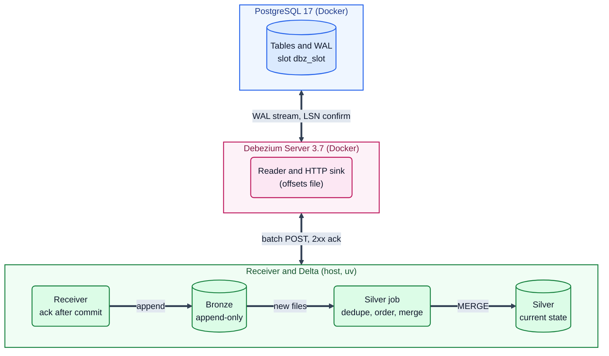
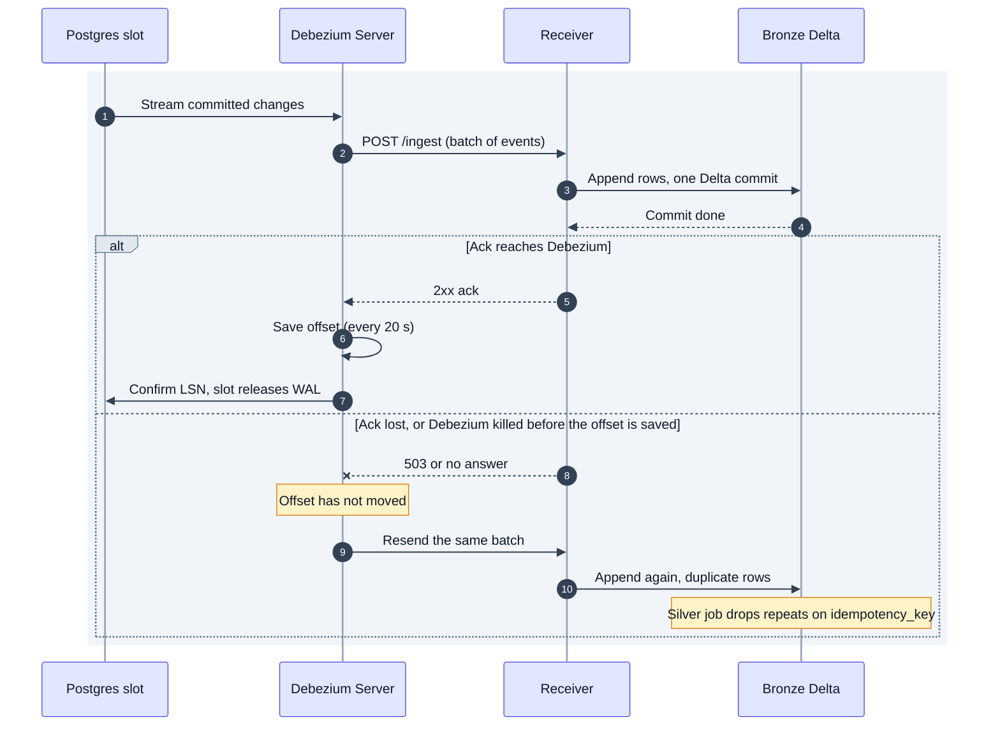
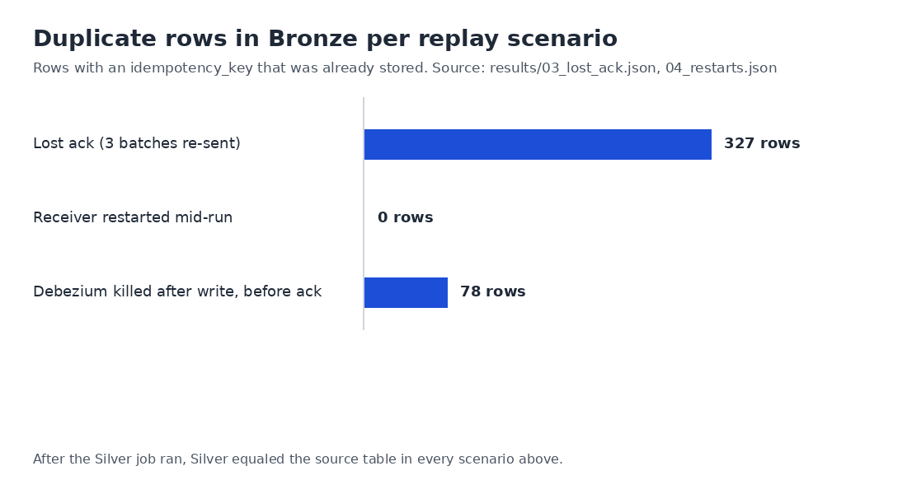
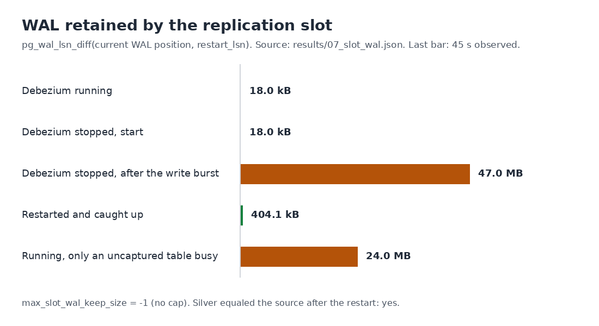
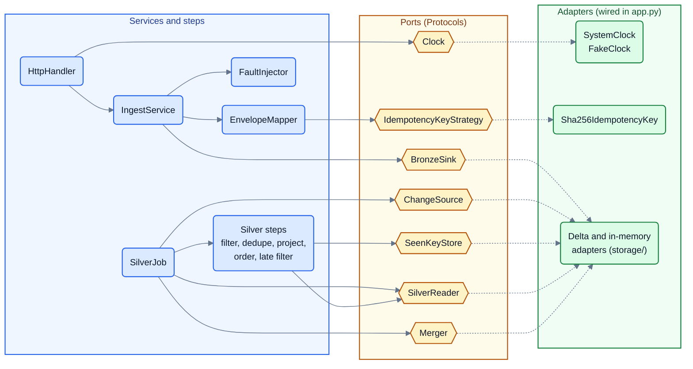

<div align="center">

<h1>Postgres CDC Into Delta Without a Broker</h1>

<p><strong>Push Postgres changes into Delta tables with Debezium Server and no Kafka, and prove it holds up under lost acks, crashes, late events and schema changes.</strong></p>

<p>


</p>

</div>

## Contents

1. [Overview](#overview)
2. [Architecture](#architecture)
3. [What it proves](#what-it-proves)
4. [Results at a glance](#results-at-a-glance)
5. [Quick start](#quick-start)
6. [Commands](#commands)
7. [Configuration](#configuration)
8. [Test suite](#test-suite)
9. [Design (SOLID)](#design-solid)
10. [Project layout](#project-layout)
11. [Troubleshooting](#troubleshooting)
12. [Limits](#limits)
13. [Cleanup](#cleanup)
14. [License and support](#license-and-support)

## Overview

Moving Postgres changes into a lakehouse table usually means running a message broker between the database and the
table writer. Pushing events straight from Debezium Server removes that broker, but it raises questions that are easy
to get wrong: what happens when an acknowledgment is lost, in what order do events apply, does a snapshot row carry a
usable log position, and what does an idle replication slot do to the disk? This project answers them with a
pipeline you can run on a laptop and eight repeatable end-to-end tests.

## Architecture

Debezium Server reads the Postgres WAL and pushes batches over HTTP to a small receiver. The receiver appends each
batch to an append-only Bronze Delta table and answers 2xx only after the commit. A Silver job removes duplicates,
orders events by LSN and merges the current state (SCD Type 1).



Thick lines carry data. An arrowhead at both ends marks a hop whose return leg is an acknowledgment: the LSN confirm to Postgres and the 2xx response to Debezium.

> [!IMPORTANT]
> The receiver is a local stand-in for a managed ingest service such as Zerobus Ingest. It proves the delivery and
> ordering logic. It does not test OAuth, gRPC streams, quotas, typed-mode errors or Unity Catalog.

### Delivery and replay

Debezium moves its offset and the slot forward only after the receiver acknowledges a batch, and the receiver
acknowledges only after the Delta commit. If the ack is lost, the batch is sent again and Bronze gets duplicate
rows. The Silver job drops them on `idempotency_key`.



## What it proves

- **No broker needed locally.** Postgres to Delta with Debezium Server and one HTTP receiver. There is no Kafka anywhere.
- **At-least-once delivery is safe.** Lost acknowledgments and crashes between write and ack produce duplicate rows in
  Bronze. Removing duplicates on `idempotency_key` keeps Silver equal to the source.
- **Ordering comes from the LSN, not arrival.** A late event with a lower LSN never overwrites newer data or brings
  back a deleted row.
- **No loss on failure.** While the sink refuses writes, neither the Debezium offsets nor the replication slot move
  past unacknowledged events.
- **Snapshot rows carry a non-null `source.lsn`**, so ordering by LSN has no NULLs to reject.
- **An envelope-shaped Bronze table survives `ADD COLUMN`** with no schema change, and Silver gains the column.
- **A replication slot holds WAL while nobody reads it**, with no cap by default.

More detail and caveats are in [docs/FINDINGS.md](docs/FINDINGS.md).

## Results at a glance

Numbers are from the latest clean run on 2026-11-27 (IST), saved in `results/`. Timing-dependent counts such as
duplicates and LSNs change a little from run to run. The pass or fail outcome does not.

<table>
  <tr>
    <td width="50%" align="center" valign="top">
      <br>
      <sub><b>Silver equals the source</b> in all eight scenarios, including a full rebuild from Bronze.</sub>
    </td>
    <td width="50%" align="center" valign="top">
      <br>
      <sub><b>At-least-once in practice:</b> 327 duplicate rows after a lost ack, 78 after a kill before the ack, 0 after a receiver restart. Silver stays correct.</sub>
    </td>
  </tr>
  <tr>
    <td width="50%" align="center" valign="top">
      <br>
      <sub><b>The slot keeps WAL while Debezium is stopped:</b> 39.6 kB to 47.1 MB, back to 543.7 kB after catch-up.</sub>
    </td>
    <td width="50%" align="left" valign="top">
      <b>Headline numbers</b>
      <ul>
        <li>Snapshot: 150 <code>read</code> rows, 0 with a NULL <code>source.lsn</code></li>
        <li>96 customers and 94 orders after 300 transactions, 83 deletes, 0 duplicates</li>
        <li>Sink refused writes, Debezium killed: all 53 refused events arrived after restart</li>
        <li>Late lower-LSN events ignored: 2</li>
        <li><code>ADD COLUMN region</code>: 73 Bronze events carry it, 44 Silver rows have it</li>
        <li>Tests: 82 unit and 8 integration passed, 242 s end to end</li>
      </ul>
    </td>
  </tr>
</table>

<details>
<summary>Full results table</summary>

| Scenario | Observed |
| --- | --- |
| Snapshot | 150 `read` rows, 0 with a NULL `source.lsn`, all at one LSN (`26569848`, `0/1956C78`). Reached Bronze 0.1 s after `up` |
| 300 transactions | Silver equals source: 96 customers, 94 orders. 83 deletes, all with `after = NULL`. 0 duplicates |
| Lost ack | **327 duplicate rows** in Bronze, Silver equals source |
| Receiver restart | 0 duplicates, Silver equals source |
| Debezium killed after write, before ack | **78 duplicate rows**, Silver equals source |
| Sink refuses writes, Debezium killed | Slot `confirmed_flush_lsn` stayed at `27194376`, below the first refused event `27232440`. All 53 refused events arrived after restart |
| Late lower-LSN events | `ignored_late = 2`, no stale value in Silver. An arrival-order apply (control) would have taken the stale name and resurrected the deleted row |
| `ADD COLUMN region` | 73 Bronze events carry `region`. Silver: 44 rows with `region`, same as the source |
| Debezium stopped | Retained WAL grew from 39.6 kB to **47.1 MB**. After restart and catch-up: 543.7 kB |
| Only an uncaptured table busy, 45 s | Retained WAL grew to **23.6 MB** while `confirmed_flush_lsn` moved 460.7 kB and `restart_lsn` moved 482.8 kB |

</details>

The images are drawn by `scripts/render_snapshots.py` from `results/*.json` and the saved command output, with no
typed-in numbers. Regenerate them after a new run with `uv run --with pillow python scripts/render_snapshots.py`.

## Quick start

### Prerequisites

| Tool | Version tested | Notes |
| --- | --- | --- |
| Docker Desktop (or Docker Engine with Compose v2) | Docker 29.8, Compose 5.5 | About 2 GB of free disk and 1.5 GB of memory for the two containers |
| [uv](https://docs.astral.sh/uv/) | 0.12 | Installs Python and the dependencies |
| Python | 3.12 | `uv` fetches it if missing (`requires-python >= 3.12`) |
| bash, curl, lsof | macOS or Linux defaults | Used by `run.sh` |

Free ports on the host: **55432** (Postgres) and **18080** (receiver). Images pulled on first run: `postgres:17.12` and
`quay.io/debezium/server:3.7.1.Final`, both pinned by digest in `docker-compose.yml`.

### Check the code (no Docker)

```bash
git clone https://github.com/santoshshinde2012/cdc-poc.git && cd cdc-poc
uv sync                 # create .venv and install dependencies, once
./run.sh check          # ruff, ruff format, mypy strict
./run.sh unit           # 82 unit tests, a few seconds
```

### Try it in one command (Docker running)

```bash
./run.sh demo           # reset, up, seed, workload, silver, verify, status. About 18 s
```

`demo` starts from a clean state, waits for the Postgres and Debezium healthchecks, runs 200 mixed transactions,
applies Bronze to Silver, and compares every row of Silver with Postgres. It leaves the stack running so you can look
around. `./run.sh down` stops it. The real output is in the [walkthrough](#walkthrough-with-real-output).

### Run the pipeline by hand (Docker running)

```bash
./run.sh up             # Postgres and Debezium in Docker, receiver on the host, snapshot starts
./run.sh seed           # load the workload procedure
./run.sh workload 200   # 200 mixed transactions
./run.sh silver         # apply the new Bronze events to Silver (wait about 20 s after the workload)
./run.sh verify         # compare every row of Silver with Postgres, exit 1 on any mismatch
./run.sh status         # slot, retained WAL, Bronze and Silver counts
./run.sh down           # stop everything, keep the data
```

> [!IMPORTANT]
> If you copied the folder or deleted `./data` but kept the Docker volume, run `./run.sh reset` once before `up`.
> Postgres and Debezium must start from the same state.

### Run everything in one go

```bash
./run.sh test           # check + unit + 8 end-to-end scenarios, about 4 minutes, needs Docker
```

`./run.sh test` creates a fresh stack, runs every scenario, writes the evidence to `results/`, and stops the
containers when it is done.

## Commands

| Command | What it does |
| --- | --- |
| `./run.sh up` | Start Postgres, the receiver (host) and Debezium Server. The first start runs the initial snapshot of 50 customers and 100 orders |
| `./run.sh seed` | Load the `run_workload` stored procedure into Postgres |
| `./run.sh workload [N] [seed]` | Run N mixed transactions (default 200) |
| `./run.sh silver [--full-refresh]` | Apply new Bronze events to Silver. `--full-refresh` rebuilds Silver from all of Bronze |
| `./run.sh verify` | Row-by-row, column-by-column diff of Postgres against Silver. Prints the first differing rows. Exit code 0 on a match, 1 on a mismatch, 2 if Postgres cannot be read. Run `silver` first |
| `./run.sh demo [N]` | `reset`, `up`, `seed`, `workload N` (default 200), `silver` until it matches, `verify`, `status`, with step headings. Leaves the stack running |
| `./run.sh status` | Slot and retained WAL, source counts, Bronze counts, duplicate rows, Silver counts |
| `./run.sh down` | Stop containers and the receiver, keep the Postgres volume and `./data`. Debezium gets up to 30 s to flush its offsets, the receiver finishes the batch it is committing |
| `./run.sh reset` | Stop, drop the Postgres volume and delete `./data` |
| `./run.sh check` | `ruff check`, `ruff format --check`, `mypy` strict. Output in `results/check-output.txt` |
| `./run.sh unit` | Unit tests, no Docker. Output in `results/unit-output.txt` |
| `./run.sh integration` | Reset the stack and run the 8 end-to-end tests. Output in `results/pytest-output.txt` |
| `./run.sh test` | `check`, `unit` and `integration` in that order |
| `./run.sh receiver-restart` | Stop and start the receiver only |
| `./run.sh logs` | Follow the receiver and Debezium logs |
| `./run.sh help` | Print the command list |

### Walkthrough with real output

Output below is from a fresh run on 2026-11-27 (IST), saved in `results/walkthrough/`.

<details>
<summary><code>./run.sh up</code>, <code>seed</code> and <code>workload 200</code></summary>

```text
$ ./run.sh up
 Container cdc-poc-postgres Started
 Container cdc-poc-postgres Healthy
receiver up (pid 79980)
 Container cdc-poc-postgres Healthy
 Container cdc-poc-debezium Started
 Container cdc-poc-postgres Healthy
 Container cdc-poc-debezium Healthy
up. Bronze: data/bronze/events  Debezium offsets: data/debezium/offsets.dat
$ ./run.sh seed
CREATE PROCEDURE
$ ./run.sh workload 200
CALL
```

Docker progress lines other than the health and start lines are left out.

</details>

<details>
<summary><code>./run.sh silver</code> prints what it applied</summary>

```text
$ ./run.sh silver
{
  "bronze_rows_read": 414,
  "bronze_files_read": 9,
  "operations_read": {
    "create": 91,
    "delete": 49,
    "heartbeat": 7,
    "read": 150,
    "update": 117
  },
  "dropped_non_row_events": 7,
  "dup_in_batch": 0,
  "dup_across_runs": 0,
  "superseded_in_batch": {
    "customers": 51,
    "orders": 116
  },
  "ignored_late": {
    "customers": 0,
    "orders": 0
  },
  "upserts": {
    "customers": 84,
    "orders": 108
  },
  "deletes": {
    "customers": 12,
    "orders": 36
  }
}
silver.customers: 84 rows
silver.orders: 108 rows
```

</details>

<details>
<summary><code>./run.sh verify</code> compares every row</summary>

```text
$ ./run.sh verify
OK       customers  source    84 rows, silver    84 rows
OK       orders     source   108 rows, silver   108 rows
verify: Silver matches Postgres row by row
```

</details>

<details>
<summary><code>./run.sh demo</code>, the whole flow in one command (18 s)</summary>

```text
$ ./run.sh demo

==> 1/7 reset: start from a clean state

==> 2/7 up: postgres, receiver, debezium (waits for healthchecks)
receiver up (pid 81033)
up. Bronze: data/bronze/events  Debezium offsets: data/debezium/offsets.dat

==> 3/7 seed: load the workload procedure
ok

==> 4/7 workload: 200 mixed transactions
CALL

==> 5/7 silver: apply Bronze to Silver until it matches Postgres (up to 180 s)
. converged

==> 6/7 verify: compare every row, every column
OK       customers  source    84 rows, silver    84 rows
OK       orders     source   108 rows, silver   108 rows
verify: Silver matches Postgres row by row

==> 7/7 status
 slot_name | active | restart_lsn | confirmed_flush_lsn | retained_wal
-----------+--------+-------------+---------------------+--------------
 dbz_slot  | t      | 0/1956C40   | 0/1973580           | 115 kB
(1 row)

source customers=84 orders=108
bronze rows 409 (heartbeats 2)
bronze duplicate rows 0 (same idempotency_key, removed by the Silver job)
shape: (9, 3)
┌──────────────────────────┬───────────┬─────┐
│ destination              ┆ operation ┆ len │
│ ---                      ┆ ---       ┆ --- │
│ str                      ┆ str       ┆ u32 │
╞══════════════════════════╪═══════════╪═════╡
│ __debezium-heartbeat.cdc ┆ heartbeat ┆ 2   │
│ cdc.public.customers     ┆ create    ┆ 46  │
│ cdc.public.customers     ┆ delete    ┆ 12  │
│ cdc.public.customers     ┆ read      ┆ 50  │
│ cdc.public.customers     ┆ update    ┆ 39  │
│ cdc.public.orders        ┆ create    ┆ 45  │
│ cdc.public.orders        ┆ delete    ┆ 37  │
│ cdc.public.orders        ┆ read      ┆ 100 │
│ cdc.public.orders        ┆ update    ┆ 78  │
└──────────────────────────┴───────────┴─────┘
silver customers 84
silver orders 108

demo finished in 18 s. The stack is still running: ./run.sh down stops it, ./run.sh reset also clears the data.
```

Docker progress lines are left out.

</details>

<details>
<summary><code>./run.sh down</code></summary>

```text
$ ./run.sh down
 Container cdc-poc-debezium Removed
 Container cdc-poc-postgres Removed
 Network cdc-poc_default Removed
```

</details>

`./run.sh status` shows the slot, the WAL it retains, the source row counts, the Bronze counts by operation, the number
of duplicate rows in Bronze and the Silver row counts. Silver (84 customers and 108 orders) equals the source. This
fresh run has no duplicate rows because nothing was replayed.

<p align="center">
  
</p>

### How Silver is verified

`./run.sh verify` reads every row of `customers` and `orders` from Postgres and every row of the Silver tables, puts
numbers and timestamps in one canonical form (`numeric` as `Decimal`, `timestamptz` as UTC), and compares the two sets
column by column. Row counts alone cannot catch a wrong value, so it does not use them. Integration test 8 runs the
command three times: it passes when Silver is current, it fails and names the row when one source row has changed
and Silver has not been updated yet, and it passes again after the Silver job runs.

```text
MISMATCH customers  source   149 rows, silver   149 rows
         only in Postgres (email, id, name, region, tier, updated_at):
           u11.1@example.com, 1, VERIFY PROBE, None, gold, 2026-11-27 17:38:10.310759+00:00
         only in Silver   (email, id, name, region, tier, updated_at):
           u11.1@example.com, 1, customer 1, None, gold, 2026-11-27 17:38:10.310759+00:00
OK       orders     source   132 rows, silver   132 rows
```

The block above is the real output of that failing run, from `results/08_verify.json`.

### Operations

| Concern | What the POC does |
| --- | --- |
| Healthchecks | Postgres (`pg_isready`) and Debezium (Quarkus `/q/health/live`). `./run.sh up` waits for both |
| Graceful shutdown | The receiver handles SIGTERM and finishes the batch it is committing before it exits. `down` gives Debezium 30 s to flush its offsets |
| Errors | `run.sh` checks for Docker, uv, a busy port and a missing Bronze table first, and says what to run next |
| Logs | The receiver writes one JSON object per line to `data/receiver.log` (`LOG_FORMAT=text` for plain text) |
| Versions | Postgres and Debezium images are pinned by tag and digest. Python dependencies are pinned in `uv.lock` |

A real receiver log line:

```json
{"ts": "2026-11-27T17:35:50.502+00:00", "level": "INFO", "logger": "cdc_poc.ingest.service", "msg": "committed to bronze", "events": 200}
```

### Fault injection

The receiver has admin endpoints that the integration tests use. You can call them by hand while a workload runs.

```bash
curl -XPOST localhost:18080/admin/fault -d '{"drop_acks": 3}'                 # commit, then answer 503
curl -XPOST localhost:18080/admin/fault -d '{"delay_acks": 5, "delay_s": 15}'  # commit, then wait before the 2xx
curl -XPOST localhost:18080/admin/fault -d '{"reject": true}'                  # answer 503 without writing
curl localhost:18080/stats                                                     # dropped acks, rejected writes
curl localhost:18080/health
```

## Configuration

### Environment variables

| Variable | Used by | Default | Meaning |
| --- | --- | --- | --- |
| `POSTGRES_PORT` | `docker-compose.yml` | `55432` | Host port mapped to Postgres. Copy `.env.example` to `.env` to change it |
| `BRONZE_PATH` | receiver | `./data/bronze/events` | Where the Bronze Delta table is written. `run.sh` sets it |
| `PORT` | receiver | `8080` | Receiver port. `run.sh` sets `18080`, which must match the Debezium sink URL |
| `HOST` | receiver | `0.0.0.0` | Receiver bind address |
| `CDC_DATA` | Silver job, verify | `./data` | Root that holds `bronze/` and `silver/`. `run.sh` sets it |
| `LOG_FORMAT` | receiver | `json` | `json` (one object per line) or `text` |

The Postgres credentials in `docker-compose.yml` and `debezium/conf/application.properties` (`app` / `app`) are for
this local demo only.

### Debezium Server properties

File: `debezium/conf/application.properties`.

| Property | Value | Why |
| --- | --- | --- |
| `debezium.sink.type` | `http` | Push events to the receiver |
| `debezium.sink.http.url` | `http://host.docker.internal:18080/ingest` | The receiver runs on the host |
| `debezium.sink.http.batch.enabled` / `batch.max-size` | `true` / `200` | One HTTP call and one Delta commit per batch |
| `debezium.sink.http.retries` / `retry.interval.ms` | `30` / `1000` | Retry until the receiver is back, so a restart loses nothing |
| `debezium.source.plugin.name` | `pgoutput` | Built-in logical decoding plugin |
| `debezium.source.slot.name` | `dbz_slot` | The replication slot to watch |
| `debezium.source.publication.name` and `autocreate.mode` | `dbz_publication`, `disabled` | The publication is created by `init.sql` |
| `debezium.source.table.include.list` | `public.customers,public.orders` | Captured tables |
| `debezium.source.snapshot.mode` | `initial` | Snapshot on first start, then stream |
| `debezium.source.decimal.handling.mode` | `string` | Keeps `numeric` values exact |
| `debezium.source.heartbeat.interval.ms` | `5000` | Heartbeat events every 5 s |
| `debezium.source.offset.storage` and `offset.flush.interval.ms` | file, `20000` | Offsets flushed every 20 s, so a hard kill can replay up to 20 s of events |
| `debezium.format.value.schemas.enable` | `false` | Plain JSON events without the schema block |

### Postgres settings

Set in `docker-compose.yml`: `wal_level=logical`, `max_replication_slots=4`, `max_wal_senders=4`,
`max_slot_wal_keep_size=-1` (no cap, which is the default and the reason the slot can fill a disk). Set in
`postgres/init.sql`: `REPLICA IDENTITY FULL` on both captured tables, so updates and deletes carry the old row.

## Test suite

`./run.sh test` ran clean on 2026-11-27 (IST) on an Apple silicon Mac: lint and format clean, mypy strict clean on
48 files, **82 unit tests passed in 10.69 s**, **8 integration tests passed in 221.40 s**, 242 s end to end.
The quality gate is local: `./run.sh check` for lint, types and unit tests, and `./run.sh test` for the full suite
including the eight end-to-end scenarios.

<p align="center">
  
</p>

### Unit tests (no Docker)

One file per component under `tests/unit/`, run against in-memory adapters, plus contract tests that run the same
assertions against the Delta and in-memory adapters (envelope parsing, idempotency keys, fault injection, HTTP
status codes, ingest service, each Silver step, the whole Silver job, store contracts).

### Integration scenarios

The eight tests run in file order against one stack and share state on purpose: snapshot, changes, replays, late
event, schema change, slot retention.

| Test | What it checks |
| --- | --- |
| `test_01_snapshot_rows_carry_lsn` | The initial snapshot arrives as 150 `read` rows and none has a NULL `source.lsn` |
| `test_02_changes_converge` | After 300 mixed transactions, Silver equals `SELECT *` on the source. Deletes have `after = NULL`. Streaming LSNs are above the snapshot LSN |
| `test_03_replay_after_lost_ack` | The receiver commits but answers 503, Debezium resends, Bronze gets duplicates, Silver still equals the source |
| `test_04_replay_after_restarts` | (a) receiver restart during a workload, (b) Debezium killed after the write but before the ack, (c) Debezium killed while the sink refuses every write. No loss, Silver equals the source each time |
| `test_05_late_lower_lsn_event_is_ignored` | A late update and a late insert for a deleted key are injected into Bronze. Silver ignores both. A full rebuild from Bronze also equals the source |
| `test_06_schema_change_add_column` | `ALTER TABLE customers ADD COLUMN region` while streaming. Bronze schema is unchanged and Silver gains `region` |
| `test_07_slot_retains_wal_while_stopped` | With Debezium stopped, the slot keeps WAL. After restart and catch-up it is released |
| `test_08_verify_command_detects_drift` | `./run.sh verify` exits 0 when Silver is current, exits 1 and names the row when one source row is ahead of Silver, and exits 0 again after the Silver job runs |

## Design (SOLID)

One package, `src/cdc_poc`, split by responsibility. Services depend on the small interfaces in `ports.py`. The
concrete Delta, HTTP and clock classes are chosen only in the two composition roots, `ingest/app.py` and
`silver/app.py`. Every port also has an in-memory implementation, so the unit tests need no Docker.



| Port | Methods | Implementations |
| --- | --- | --- |
| `BronzeSink` | `append(rows)` | `DeltaBronzeWriter`, `InMemoryBronze` |
| `ChangeSource` | `read_new()`, `commit(batch)` | `DeltaBronzeReader`, `InMemoryBronzeReader` |
| `CheckpointStore` | `load()`, `save(processed)` | `FileCheckpointStore`, `InMemoryCheckpointStore` |
| `SeenKeyStore` | `drop_seen(frame)`, `remember(keys)` | `DeltaSeenKeyStore`, `InMemorySeenKeyStore` |
| `SilverReader` | `read(table)`, `schema(table)`, `delete_markers(table)` | `DeltaSilverStore`, `InMemorySilverStore` |
| `Merger` | `merge(table, changes, keys)` | `DeltaScd1Merger`, `InMemoryScd1Merger` |
| `SourceReader` | `rows(table)` | `PsqlSourceReader` (used by `verify`) |
| `Clock` | `now()`, `sleep(s)` | `SystemClock`, `FakeClock` |
| `IdempotencyKeyStrategy` | `key(dest, key, op, pos)` | `Sha256IdempotencyKey` |

| Principle | Where it shows |
| --- | --- |
| **S**ingle responsibility | One class per job: parsing, the key, the writer, the transport, faults, cleaning, dedupe, ordering and merging each sit in their own module |
| **O**pen/closed | A new store (for example a Unity Catalog table) or a new key strategy is a new class behind an existing port. `SilverJob`, `IngestService` and the steps do not change |
| **L**iskov substitution | `tests/unit/test_silver_job.py` runs every scenario against both the Delta and the in-memory adapters with the same assertions. `test_stores.py` checks each port's contract on both |
| **I**nterface segregation | Read and write are split: `SilverReader` vs `Merger`, and `BronzeSink` vs `ChangeSource`. `LateEventFilter` needs only `SilverReader`, `Deduper` needs only `SeenKeyStore` |
| **D**ependency inversion | Services take ports in their constructors. Only `ingest/app.py` and `silver/app.py` import `storage.delta`, and nothing reads globals or the environment outside them |

### Bronze envelope schema

One row per event, with a fixed schema that never changes when the source does:

`destination`, `operation` (`create`, `read`, `update`, `delete`, `truncate`, `heartbeat`, `tombstone`), `key`
(JSON of the primary key), `before`, `after`, `value` (full event JSON), `source_lsn`, `source_sequence`,
`source_txid`, `source_snapshot`, `source_ts_ms`, `event_ts_ms`, `idempotency_key`, `ingest_batch_id`, `ingest_ts`.

`idempotency_key = sha256(destination | key | operation | {lsn, sequence, txId})`. A redelivered event gets the
same key.

### Silver job steps

`SilverJob.run()` runs these steps, each in its own class:

1. `ChangeSource.read_new()`: only Bronze files not processed yet (Bronze is append-only).
2. `RowEventFilter`: drop heartbeat, tombstone and other non-row events.
3. `Deduper`: remove repeats on `idempotency_key`, inside the batch and against keys seen in earlier runs.
4. `ImageProjector`: typed columns from `after`, or from `before` for deletes.
5. `LsnOrderer`: keep the highest `source_lsn` per key. A NULL LSN is an error.
6. `LateEventFilter`: drop events whose LSN is not above what Silver already applied for the key. Delete markers
   keep the LSN of each delete, so a late insert cannot bring a deleted row back.
7. `Merger.merge()`: deletes remove the row, everything else upserts. New source columns are added.
8. `ChangeSource.commit()`: mark the files processed.

<details>
<summary>Modules, one responsibility each</summary>

| Module | One responsibility |
| --- | --- |
| `config.py` | `ReceiverConfig`, `SilverConfig`: paths, ports and table keys, read once from the environment |
| `domain.py` | `Operation`, `EnvelopeRow`, Debezium op codes, heartbeat names |
| `ports.py` | The interfaces above, plus `ChangeBatch` |
| `clock.py` | `SystemClock`, `FakeClock` |
| `ingest/envelope.py` | One Debezium event becomes one `EnvelopeRow` |
| `ingest/idempotency.py` | `Sha256IdempotencyKey` |
| `ingest/faults.py` | `FaultInjector`: lose an ack, delay an ack, refuse writes |
| `ingest/service.py` | `IngestService`: write the batch, ack only after the write returns |
| `ingest/http.py` | HTTP transport: routes and status codes, no business rules |
| `ingest/lifecycle.py` | Graceful shutdown: stop on SIGTERM or SIGINT, wait for the batch in flight |
| `ingest/app.py` | Receiver composition root and `cdc-receiver` entry point |
| `logging_setup.py` | `JsonFormatter` and `configure_logging` |
| `storage/bronze_schema.py` | The Bronze Arrow schema shared by every Bronze store |
| `storage/delta.py` | Delta adapters: Bronze writer and reader, checkpoint file, seen keys, Silver store, SCD1 merger |
| `storage/postgres.py` | `PsqlSourceReader`: reads source rows through `psql` in the compose service |
| `storage/memory.py` | In-memory adapters for the same ports |
| `silver/cleaner.py` | `RowEventFilter` |
| `silver/deduper.py` | `Deduper` |
| `silver/projector.py` | `ImageProjector` |
| `silver/ordering.py` | `LsnOrderer` and `LateEventFilter` |
| `silver/job.py` | `SilverJob`: runs the steps in order and keeps stats, knows no storage details |
| `silver/app.py` | Silver composition roots and `cdc-silver` entry point |
| `verify/normalize.py` | Canonical form for numbers and timestamps so Postgres and Silver values compare equal |
| `verify/differ.py` | `SilverVerifier`: row-level diff of the source against Silver, `VerifyReport` |
| `verify/app.py` | Verify composition root and `cdc-verify` entry point (exit code 0, 1 or 2) |

</details>

## Project layout

```text
cdc-poc/
  pyproject.toml                one uv project: package, scripts, ruff, mypy, pytest
  uv.lock                       pinned dependencies
  docker-compose.yml            postgres:17.12 and quay.io/debezium/server:3.7.1.Final, pinned by digest, with healthchecks
  run.sh                        up, seed, workload, silver, verify, demo, status, unit, check, integration, test, down, reset
  .env.example                  optional overrides (Postgres host port)
  postgres/                     init.sql (tables, REPLICA IDENTITY FULL, publication, seed rows), workload.sql
  debezium/conf/                application.properties
  src/cdc_poc/                  config, domain, ports, clock, logging_setup, ingest/, storage/, silver/, verify/
  tests/unit/                   no Docker: one file per component, plus Delta vs in-memory contract tests
  tests/integration/            the 8 end-to-end tests against Postgres and Debezium
  scripts/render_snapshots.py   draws docs/images from results/
  docs/images/                  result images used in this README
  docs/FINDINGS.md              what the run showed, what it means, what it does not cover
  results/                      output of the last run: summaries, per-test JSON, walkthrough output
  data/                         Bronze, Silver, Debezium offsets, receiver log (created at runtime, not in git)
```

## Troubleshooting

| Symptom | Cause and fix |
| --- | --- |
| `no space left on device`, image pull fails, Postgres will not start | Docker Desktop's disk is full. Run `docker system df`, then `docker image prune` and `docker builder prune`. Do not run `docker volume prune` if you want to keep other projects' data |
| `port is already allocated` or `address already in use` on 55432 | Another Postgres is using the port. Set `POSTGRES_PORT=55433` in `.env` (copy `.env.example`) |
| `error: port 18080 is already in use` or `the receiver did not start` | Something else holds 18080. Run `lsof -iTCP:18080 -sTCP:LISTEN`, stop it, or run `./run.sh down` to stop an old receiver. The last lines of `data/receiver.log` are printed for you |
| `error: the Docker daemon is not running` or `uv not found` | Start Docker Desktop, or install uv, then rerun |
| `error: postgres is not running` | Run `./run.sh up` first |
| `error: no Bronze table yet` | Run `./run.sh up` and give Debezium a few seconds to take the snapshot, then `./run.sh silver` |
| `./run.sh verify` prints `MISMATCH` | Silver is behind. Run `./run.sh silver` and verify again. If it still differs after Debezium has caught up, the report lists the rows that differ |
| `debezium did not become healthy` | The log tail is printed. Usual causes: the Postgres volume and `./data` are out of step (run `./run.sh reset`), or no memory left for the container |
| Debezium logs `Connection refused` or timeouts to the sink | Debezium reaches the host receiver through `host.docker.internal`. Docker Desktop provides it. On Linux Engine the `extra_hosts: host.docker.internal:host-gateway` entry in the compose file does it. Check `curl localhost:18080/health` on the host |
| Postgres disk keeps growing while Debezium is stopped | Expected: a replication slot keeps WAL until its consumer confirms it, and `max_slot_wal_keep_size = -1` has no cap. Start Debezium, or drop the slot (`SELECT pg_drop_replication_slot('dbz_slot')`) if you abandon the project. In production, set a cap and alert on slot lag |
| `retained_wal` stays high although Debezium is running | `restart_lsn` can lag `confirmed_flush_lsn` until a checkpoint and one more captured change. Run `CHECKPOINT;` and change one captured row, then check `./run.sh status` again |
| Silver and source differ right after a workload | Debezium and the receiver are still catching up. Wait 20 s, run `./run.sh silver` again, then `./run.sh verify` |
| Integration test fails on a slow machine | Timeouts are 150 to 240 s. Close other heavy containers, then rerun `./run.sh integration` |
| Want a clean slate | `./run.sh reset`. The integration run does this itself at the start |

## Limits

- **The HTTP sink stands in for a managed ingest service.** It proves the delivery and ordering logic. It does not
  test OAuth, gRPC streams, quotas, typed-mode errors or Unity Catalog.
- **Tombstones never arrive.** The Debezium HTTP sink skips records with a null value, so Bronze has 0 tombstone
  rows. The Silver filter handles them anyway, and a unit test covers it.
- **No AUTO CDC.** Silver is a hand-written dedupe, order and MERGE job (SCD Type 1). It mirrors the steps of a
  managed `AUTO CDC ... SEQUENCE BY` flow but is not that feature.
- Delta is written with delta-rs on local files, with one commit per HTTP batch and no compaction. The receiver is
  single-writer.
- Not covered: TOAST values, tables without a primary key, several slots or consumers, a Postgres crash (as
  opposed to a Debezium crash), and anything at production volume.

## Cleanup

```bash
./run.sh down      # stop containers and the receiver, keep the volume and ./data
./run.sh reset     # also drop the Postgres volume and delete ./data
docker image rm postgres:17.12 quay.io/debezium/server:3.7.1.Final   # optional, frees the image space
rm -rf .venv       # optional
```

## License and support

Released under the [MIT license](LICENSE). Copyright (c) 2026 Santosh Shinde.

If this saved you time, you can [buy me a coffee](https://buymeacoffee.com/santoshshin).
